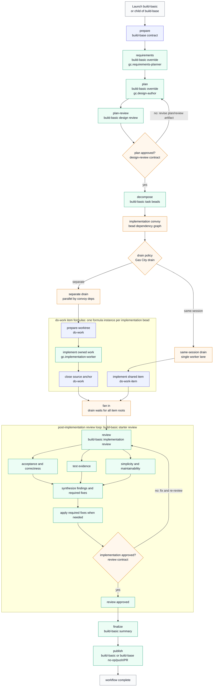

# Gas City Build Pack (`gc`)

This is the base pack for running full software-delivery workflows in Gas
City: gather requirements, write and review a plan, decompose into tasks,
implement in parallel agent sessions, review the result, and optionally
publish. It ships three things:

- **Workflow formulas** — `build-basic` (the starter factory), the
  `build-from-*` continuation entrypoints, direct `implement`, and GitHub
  adapter workflows (issue triage, issue fix, PR review).
- **The `gc.mayor` coordinator skill** — a user-facing planner that gathers
  requirements, writes plans, creates approved beads/convoys, and launches
  the right formula for you.
- **The `build-base` contract** — the virtual stage sequence that the
  methodology packs in this repository (bmad, compound-engineering,
  superpowers, gstack) extend and override.

Managed workspace checks retain the original cooked workflow context separately
from the rows guarded by each write. Formula metadata uses the expansion's saved
variables and formula defaults; unresolved or changed writer designations refuse
admission. Checkout validates retained source rows before following their references
and advances them only after confirming its own write.
Boolean and numeric formula variables use JSON text when read from Beads metadata.
Guarded writes retain the original metadata types and values.
Changed repeated rows still refuse admission; bounded private diagnostics retain the
conflicting rows, revisions, hashes and changed JSON paths without refreshing them.
Controller-created retry attempts and Ralph iterations join their exact original
compiled seed and frozen native specification. Earlier attempts remain read-only
history; only the current claimed occurrence can publish records.
Native child steps inherit source membership through the validated continuation;
conflicting membership on an individual step still refuses admission.
See the [workspace access contract](schemas/workspace/access.md#bind-the-writer)
for the read and transaction limits.

## Quick Start: your first build

Prerequisites: Gas City installed and a city running (`gc init`, `gc start`),
and your project added as a rig (`gc rig add .` inside the repo). Use matching
Gas City core and pack versions. See
[worktree configuration](docs/worktree-dependencies.md#source-lifecycle) for
lifecycle modes and prerequisites, and the [repository README](../README.md)
for the from-scratch path.

1. Import formulas, claim command, and rig roles. From city directory:

   ```sh
   gc import add --name gc https://github.com/gastownhall/gascity-packs.git//gascity
   ```

   Then add rig-scoped roles in `city.toml` and run `gc import install`:

   ```toml
   [[rigs]]
   name = "your-project"

   [rigs.imports.gc]
   source = "https://github.com/gastownhall/gascity-packs.git//gascity/roles"

   [rigs.formula_vars]
   worktree_checks = '{"required_checks":[{"argv":["make","test"],"id":"project-tests"}]}'
   ```

   Both imports are required. The rig-scoped roles pack supplies agents but,
   by design, rig imports do not register city commands; importing roles alone
   renders prompts that reference `gc gc claim` without installing that
   command. Keep the top-level Gas City pack imported at city scope.

   (Contributors hacking on packs can point this source at a local clone.)

   Replace `make test` with your project's checks. The registered repository
   must contain a commit. See [worktree configuration](docs/worktree-dependencies.md#configure-the-run)
   for the base commit and required-check contract.

2. Create a bead describing what you want built, and sling the starter
   factory at it:

   ```sh
   gc bd create "Add a --json flag to the export command"
   gc sling gc.run-operator <bead-id> --on build-basic \
     --var artifact_root=plans/json-flag/build
   ```

3. Watch it run. The workflow walks requirements → plan → plan review →
   decompose → parallel implementation → a three-lane starter review
   (acceptance, test evidence, simplicity) → finalize. Attach to any agent
   session with `gc session attach <name>`, or inspect the workflow root
   bead as stages record their artifacts.

4. Read the results under `artifact_root` in your rig: `requirements.md`,
   the implementation plan, review reports, and `factory-run.md` — a short
   summary of what ran, what was proven, and the suggested next action.

Prefer a guided experience? Run the coordinator skill instead and let it do
the planning and launching:

```text
Use skill gc.mayor
```

## Choosing an entrypoint

An idea or request is the input to the Software Development Lifecycle (SDLC).
The `build-from-*` continuation formulas are named for the point where they
enter it. For example, `build-from-requirements` starts at Requirements and
gathers requirements from the idea or request you provide.

Each full-lifecycle formula runs from its starting phase through a complete,
tested, and reviewed implementation with any required review fixes applied,
plus a final report. The result may remain local, be pushed, or be published
as a PR.

The SDLC phases are:

- Requirements
- Implementation Planning
- Plan Review
- Plan Decomposition into beads
- Implementation and Testing
- Implementation Review/Fix
- Finalization
- Optional Publication (push or PR)

| What you have | Public formula | SDLC phase you're starting from |
| --- | --- | --- |
| A target bead containing an idea or request | `build-basic` | Requirements |
| An idea or request recorded in a task | `build-from-requirements` | Requirements |
| An approved requirements (aka plan) Markdown file | `build-from-plan` | Implementation Planning |
| Approved requirements and a reviewed implementation plan | `build-from-decompose` | Plan Decomposition |
| A Gas City implementation convoy and its requirements, implementation plan, and decomposition | `build-from-convoy` | Implementation |

### Focused workflows

| What you want to do | Public formula | Successful output or boundary |
| --- | --- | --- |
| Harden an implementation plan | `design-review` | Revised implementation plan approved or blocked by its review loop |
| Implement an approved convoy without the full build suffix | `implement` | Implementation summary and optional publication; no normal review/fix/finalize suffix |
| Resume an existing Gas City build at implementation review | `build-from-review` | Full-lifecycle output described above; requires its upstream build artifacts and implementation evidence |
| Review an implementation | `review` | Review report only |
| Check requirements and implementation coverage | `gap-analysis` | Coverage report only |
| Assess a GitHub issue | `github-issue-triage` | Triage report and a sticky issue comment, created or updated; no implementation |
| Fix a GitHub issue | `github-issue-fix` | Implemented and reviewed issue fix; sticky issue-fix status comment created or updated; optional draft or ready PR |
| Review a GitHub PR | `github-pr-review` | Review report and a sticky PR comment for the current head, created or updated; no code changes, formal GitHub review, or merge |

The normal build continuations use one implementation-plan review gate; a required-changes or blocked verdict stops the continuation. `design-review` and `github-issue-fix` provide review loops that harden an implementation plan. Testing evidence is required; TDD is not. `gc.mayor` can gather the upstream artifact paths needed by the continuation formulas.

Discover everything that is launchable from the active rig/city context:

```sh
gc formula catalog --json
gc formula show implement --json
```

Launch implementation directly against an approved implementation convoy:

```sh
gc sling gc.run-operator <convoy-id> --on implement \
  --var context_path=<optional-context-yaml> \
  --var drain_policy=separate
```

## Launch variables that matter

Every build entrypoint accepts the same knobs. Set them with `--var k=v` at
launch or pin them in a rig's `formula_vars`:

| Variable | Default | What it changes |
| -------- | ------- | --------------- |
| `artifact_root` | (required) | Where build artifacts land. Relative overrides resolve from the command's working directory; absolute paths are used directly. |
| `interaction_mode` | `interactive` | `interactive` keeps blocking questions and approval menus; `autonomous` decides and records evidence; `headless` never prompts. |
| `review_mode` | `agent` | `report` is read-only findings; `agent` is a structured fix handoff; `interactive` may apply safe fixes directly. |
| `drain_policy` | `separate` | `separate` runs implementation beads in parallel worker sessions; `same-session` runs them serially in one shared session. |
| `implementation_target` | `gc.implementation-worker` | The rig role that implements each work item. |
| `push` / `open_pr` | `false` | Allow the publish stage to push and open a PR after all checks pass. |
| `max_iterations` | `10` | Bound on implementation/review fix attempts. |
| `worktree_lifecycle` | `new` | Recorded source inputs, owned workspaces and qualified output handoff. Other modes require explicit migration. |
| `worktree_run_root` | empty | Locates an original run for a separate suffix; actual native source relationships must authorize it. |
| `worktree_base_ref` | `@default` | Explicit first-capture policy for the verified registered checkout; records its exact commit once. Empty or missing is invalid. |
| `worktree_checks` | empty | Canonical JSON `required_checks: [{id, argv}]`, required and captured on the run. |
| `worktree_parent` | empty | Default rig workspace parent, or an absolute existing directory. |
| `worktree_name_prefix` | empty | Prefix for the stable `<owner>-g<generation>` directory name. |
| `worktree_allow_external_parent` | `false` | Explicit permission for a parent outside the rig. |

For recorded bases, source dependencies, shared workspaces, and recovery, see
[Worktree dependencies](docs/worktree-dependencies.md).
Custom parent and prefix settings are recorded per workspace. See
[layout configuration](docs/worktree-dependencies.md#configure-layout).
Explicit implementation, review, and fix launches must pass these three settings
from the original native workflow root; child defaults do not replace them.
The base build and issue-fix workflows carry them into their nested review
formulas as well.

When variables are not enough, every stage prompt can be replaced by dropping
a Markdown file at the same relative path in a higher-priority layer, and
every documented step can be swapped for your own expansion — see "Stable
Workflow Override Interface" below for the recipe and per-stage examples.

An initial planning or decomposition entry can capture a new run from a real
request task or convoy, its registered repository and configured check policy.
Approved artifacts supply that stage's prerequisites. They do not supply its
source identity. For example:

```sh
gc sling gc.run-operator <request-id> --on build-from-decompose \
  --var artifact_root=<artifact-dir> \
  --var requirements_path=<artifact-dir>/requirements.md \
  --var plan_path=<artifact-dir>/implementation-plan.md \
  --var plan_review_path=<artifact-dir>/plan-review.md \
  --var worktree_lifecycle=new \
  --var drain_policy=separate
```

For recorded work, launch the matching suffix against its implementation convoy
or original native source. When that source does not point back to the run,
include `--var worktree_run_root=<original-workflow-root>`. The helper verifies
the source relationship, run, plan, generation and captured configuration;
the selector alone grants no authority. Review and implementation entries need
the declared plan and their upstream evidence. See
[continuing work](docs/worktree-dependencies.md#continue-existing-work).

Launch a continuation against a real task or convoy. Each continuation validates
the artifacts you hand it before doing any work,
records the entrypoint it started from, and refuses to finalize as a pass when
review or repair is still blocked — see "Choosing an entrypoint" above for
which one matches the artifacts you have.

Every formula in this pack uses `contract = "graph.v2"`. Targeted formulas take
the core-injected reserved convoy target; they do not declare `issue`,
`bead_id`, or `convoy_id` variables. `drain_policy=separate` is the standalone
default. Use `same-session` only when preserving one shared worktree and
conversation is explicitly desired and core shared drain support is available.

The pack ships its city-scoped claim command alongside formulas, plus
providerless rig role agents under `gascity/roles`. Standalone use requires
the top-level `gc` import for formulas, mayor skill, and `gc gc claim`, and
`gascity/roles` on each target rig for `gc.*` role agents.

Workspace helpers run through `gc gc workspace entry`, `dependency`, `checkout`,
`runtime`, and `flow`. For another pack helper, obtain the imported scripts
directory in the same shell:

```sh
PACK_SCRIPTS=$(gc gc workspace scripts-path) || exit "$?"
python3 "$PACK_SCRIPTS/formula_methodology.py" --help
```

Use the normal city and rig selection for the intended workflow. This resolves
both local checkouts and cached imports without a formula `pack_root` variable.
See [workspace commands](commands/workspace/help.md) and the
[workspace entry contract](assets/workflows/workspace-entry.md) for native identity
and action arguments.

Import roles for each target rig. By default agents inherit city/workspace
provider; advanced users can patch individual roles without overriding formulas:

```toml
[[rigs]]
name = "my-repo"

[rigs.imports.gc]
source = "/path/to/gascity/roles"

[[rigs.patches]]
agent = "gc.implementation-worker"
provider = "your-provider"
```

Launch formulas from target rig context, or pass normal `--rig <target-rig>`
selection so `gc.run-operator` resolves to rig-local role.

The claim command can deliver an expanded workflow root as a launch anchor.
Workers keep that root open and use the same claim command for its next native
step; they do not fail or close it because its kind is `workflow`.

The anchor handoff applies only when the claimed bead's own record has the
expanded-workflow metadata. A `root_bead_id` on an ordinary task records its
lineage, not its kind. For ordinary claimed tasks, workers read the description
and any external prompt it names before claiming again.

During item preparation, the [shared recipe](assets/workflows/do-work/prepare-worktree.md)
runs `workspace_entry.py read --require-plan` to discover the original run and
the plan's producer through the native drain relationship. A source-plan
reference need not be stored on the item root or original workflow root.
The recipe reads the generation from the exact drain member (or current input
convoy for a non-drain claim) before invoking that strict entry check.
The recipe retains that entry JSON and reads the exact claimed native row, then
runs the dependency helper with the returned logical root, physical unit convoy,
generation, store and uniquely declared member/owner. Run the source-row
derivation, entry read and dependency preparation in one shell with the native
claim context and existing external artifact/evidence directories. Do not
substitute example IDs or the synthetic unit convoy for the source member.
Preparation refuses missing or stale predecessor acceptance before
record or checkout allocation; an independent member starts at the captured base.

If the initial and continuation reads disagree, entry still refuses. A bounded
private diagnostic under the city's `.gc/workspace-entry-diagnostics` retains
the overlapping rows, revisions, hashes and changed JSON paths; the error names
the file and its hash. Keep those row contents private. A diagnostic write
failure also refuses entry and does not authorize a retry or a metadata edit.

Default formula routes use these qualified targets: `gc.run-operator`,
`gc.requirements-planner`, `gc.design-author`, `gc.task-decomposer`,
`gc.issue-triager`, `gc.design-implementation-reviewer`,
`gc.design-test-risk-reviewer`, `gc.review-synthesizer`,
`gc.implementation-worker`, `gc.gap-analyst`, `gc.implementation-reviewer`,
and `gc.publisher`.

## Build Methodology Contract

The default `build-basic` requirements stage reads the original native request
and declared context/behavior inputs before drafting. The requirements preserve
the full requested behavior, source topology and constraints. `worktree_checks`
supplies validation policy. Missing or inconsistent required inputs block the
stage. See the [requirements recipe](assets/workflows/build-basic/requirements.md).

`build-base` is the virtual full-lifecycle workflow contract. It defines the
stable stage sequence that concrete build methodology packs can override:

```text
prepare -> requirements -> plan -> plan-review -> decompose ->
implement | implement-same-session -> review -> finalize -> publish
```

`build-base` is internal and should not be launched directly. Use
`build-basic` for the default Gas City implementation. It maps the base stages
onto the existing Gas City requirements, implementation-plan, design-review,
create-beads, implementation, post-implementation review, and publish helpers.
Gap-analysis is a review lens inside the post-implementation review loop, so
coverage findings are synthesized and fixed with the rest of the review output.

Default plan review accepts only an approved current plan with a passing review
bound to its exact plan and upstream bytes. Blocking findings, stale approval,
and missing evidence refuse task allocation. See
[plan-review acceptance](docs/plan-review-acceptance.md) for the report contract
and bounded repair behavior.

Continuation bases are nested suffixes. Each base validates its prerequisite
inputs, performs one stage or handoff, and delegates to the next suffix:

```text
build-from-requirements-base
  -> build-from-plan-base
  -> build-from-decompose-base
  -> build-from-convoy-base
  -> build-from-review-base
```

The cataloged `build-from-*` formulas are thin default Gas City wrappers around
those bases. Methodology packs that want the same entrypoints should extend the
matching `build-from-*-base` formula and override selector defaults, routes,
drain item formulas, or review expansions instead of copying the suffix graph.

Builds and continuations use one native `build-body` scope for required stages:

- **Failed stage:** once its configured retries are exhausted, the pipeline
  fails and remaining work is skipped. Implementation, finalization and
  publication cannot start from a failed prerequisite.
- **Repair attempts:** artifact checks and review loops keep their existing
  attempt limits. A failed attempt can still be repaired before the logical
  stage fails.
- **Pack overrides:** replacement steps retain `gc.scope_ref = "build-body"`
  and `gc.on_fail = "abort_scope"`. Expanded stages pass
  `failure_scope = "build-body"` to their templates. Added required stages
  also belong in the scope body's prerequisites.

The scope body is a native control, with no worker route. Functional stages
such as `finalize` and `publish` are required members, rather than teardown.
Cleanup may run after failure only when explicitly authored as native teardown.

Plan-review repair distinguishes current repair inputs from approval. A blocked
default reviewer records the exact plan/requirements bytes and its native
claim/attempt as `repair_subject`, including when a malformed trace prevents a
complete approval subject. The next authorized author verifies the current
native report path/hash and preceding failed reviewer before editing the plan.
Changed inputs or a report replayed into a later attempt refuse repair. A new
independent review must still validate every upstream file before approval or
task creation. See [Plan-review acceptance](docs/plan-review-acceptance.md).

Third-party methodology packs can extend `build-base` and override only the
stages they need. For implementation, packs should keep the Gas City drain
lifecycle and point the two static drain steps at pack-specific item formulas
that extend `do-work` and `do-work-item`. The repository currently ships
concrete vendored implementations for Compound Engineering, Superpowers, BMAD
Method, and garrytan/gstack. Those packs import this pack as `gc` internally,
so users can import one methodology pack at city scope while keeping the
existing `gc.*` role override surface for rig agents.

Third-party packs should treat upstream agent definitions, prompts, and skills
as vendored methodology inputs, not as runtime authority. When an upstream
methodology says to spawn subagents, dispatch a task tool, or run a plugin
command, the pack should convert that shape into a Gas City formula or expansion
with explicit `gc.*` lanes. The model may read the upstream persona or prompt
file for behavior, but work routing, retries, persistence, and fanout/fanin must
remain in the Gas City graph.

Raw-framework subagents become Gas City fanouts. That is the core rule for
methodology packs: preserve the user-visible process, reviewer perspective, and
handoff order, but make the routing durable through beads, drains, formulas, and
expansion children. Structured step-file prompts are usually good candidates for
separate formulas or expansion loops because Gas City can then retry, observe,
and resume each step independently.

Use these mode inputs when designing or launching methodology formulas:

- `worktree_lifecycle=new` uses the native entry,
  source-selection, checkout, acceptance and guarded record helpers. Initial
  capture freezes the registered base and project check policy atomically.
  Native drains and explicit child launches retain the original mode and policy.
  Continuations must prove the original run and current source generation.
  Legacy or unclassified work requires [explicit migration](docs/worktree-dependencies.md#migrate-existing-work).
  Use a matched core/pack revision qualified for the intended workflow.
  Native worker execution and installation remain unverified in this candidate.

- `interaction_mode` controls human participation in planning and gates.
  `interactive` preserves blocking questions and approval menus, `autonomous`
  lets the workflow make reasonable decisions while recording evidence, and
  `headless` is for automation with no blocking prompts.
- `review_mode` controls review authority. `report` is read-only output for
  adapters such as GitHub PR comments, `agent` is a structured machine handoff
  whose caller applies fixes, and `interactive` preserves a raw top-level review
  experience that may apply safe fixes when the methodology allows it.

Build preparation and GitHub adapters read compatibility through
`assets/scripts/formula_methodology.py`. It parses the complete native formula
result and prints only the formula name and methodology declaration. An
unreadable result blocks the workflow. Builds require a declaration. GitHub
adapters treat verified absence as unconstrained and validate declared modes.

The current cross-framework audit and follow-up proposal lives in
[`docs/design/build-methodology-framework-audit.md`](../docs/design/build-methodology-framework-audit.md).

## Requirements Ledgers

This base pack keeps product requirements beside the formula implementation:

- `REQUIREMENTS.md` defines the build methodology base contract and the default
  `build-basic` implementation expectations.
- `formulas/REQUIREMENTS.md` contains one durable behavior row for every base
  pack formula.

When a base formula's stage order, selector variables, drain behavior, artifact
contract, fanout/fanin, review loop, adapter side effect, or catalog surface
changes, update the matching requirements row in the same change. The formula
asset tests fail if a formula exists without a requirements row.

## Build Flow

New mode wires accepted source selection through owned checkout preparation,
independent project checks/review, result checkpoints, canonical review and
publication. Source access requires the recorded new lifecycle; legacy or
unclassified work stops for explicit migration. The candidate's source and component
checks do not establish native worker execution or installation acceptance.

- **Configuration and recovery:** [Worktree dependencies](docs/worktree-dependencies.md).
- **Records and authority:** [record contracts](schemas/workspace/README.md) and
  [guarded record access](schemas/workspace/access.md).
- **Source inputs:** [source plans](schemas/workspace/source-plans.md) and
  [accepted inputs](schemas/workspace/source-inputs.md).
- **Owned checkout:** [preparation and continuation](assets/scripts/workspace_checkout.md).
- **Checks, review and publication:** [native runtime](assets/scripts/workspace_runtime.md)
  and [qualified outputs](assets/scripts/workspace_outputs.md).
- **Source and behavior checks:** [closed inventory](schemas/workspace/discovery.md)
  and [acceptance fixture](tests/fixtures/workspace-acceptance/README.md).
- **Imported helpers:** [workspace entry contract](assets/workflows/workspace-entry.md).
  Use `gc gc workspace` for lifecycle helpers and native `gc.check_path` for gates,
  keeping helpers with their pack schemas.

The city-scoped command `gc gc workspace` exposes the entry, dependency,
checkout, runtime and flow helpers from the installed pack. Native qualifiers
supply physical identities and frozen policy. Workers do not construct callbacks.
Native retry and iteration steps retain their compiled writer responsibilities;
control steps cannot write lifecycle records. See [guarded record access](schemas/workspace/access.md#bind-the-writer).

Flow operations and runtime result publication serialize native admission and
readback for the same repository, workflow root and generation. Programmatic
writers use [`WorkspaceFlow.open` or `NativeSourceRuntime.open`](assets/scripts/workspace_runtime.md#callable-interface)
so each operation retains its native rows after acquiring the lock. Contention
refuses before allocation or submission; an unresolved write still requires its
original request.

For a blocked first preparation, use the dependency helper's
[recovery decision](schemas/workspace/source-inputs.md#retry-first-preparation).
The retry retains the captured source and recorded workspace layout.

`build-base` is the virtual contract. `build-basic` is the concrete Gas City
implementation that demonstrates the override surface without vendoring a
third-party methodology.



Blue nodes are the base contract or inherited item lifecycle, green nodes are
the concrete `build-basic` implementation, and amber nodes are Gas City graph,
convoy, or drain infrastructure. Concrete methodology packs extend the same
shape: they can override requirements, planning, review fanout, item formulas,
or finalization while preserving the convoy/drain/fan-in mechanics. The
`build-basic` review expands into acceptance, test-evidence and simplicity
lanes before synthesis and repair. Methodology packs retain their own review
lanes and bounded repair loops.

## Stable Workflow Override Interface

This section is the external compatibility promise for this pack's workflow
customization surface. The pack exposes two stable customization modes:

1. **Basic asset shadowing.** Put a Markdown file at the same relative path in a
   higher-priority city or local pack layer. Formula step bodies live at
   `assets/workflows/<formula>/<step-id>.md`. Gas City resolves these
   `description_file` assets through the normal import/layer search path, so the
   shadowing file replaces the base prompt text without changing the formula
   graph.
2. **Advanced step override.** Copy the formula into a higher-priority formula
   layer and replace the documented step block. Preserve the formula name, vars,
   metadata keys, dependency edges, and sink contracts that downstream steps
   still depend on. Use this when you need to replace one step with another
   formula, an expansion, a wider fanout, a retry loop, or a different agent
   route.

Only the override points below are intended as stable public interfaces. Other
steps may be useful to inspect, but they are implementation details unless they
are listed here.

When overriding a step that writes a downstream artifact, keep the artifact
contract stable:

- Verdict reports must use `schema: gc.verdict-report.v1` with
  `verdict: pass|fail`.
- GitHub issue triage reports must use `schema:
  gc.github-issue-triage-report.v1`.
- GitHub adapter workflows must preserve the documented `gc.github.*` metadata
  on the workflow root bead.
- Build and implementation workflows must not close the input convoy head unless
  the base step explicitly does so.
- Steps that only validate context must not mutate source files.

### GitHub Issue Triage

Use this when you want project-specific triage instructions for issue labels,
severity, evidence requirements, or public comment style.

Stable basic override:
`assets/workflows/github-issue-triage-base/write-triage-report.md`

Stable advanced step:
`github-issue-triage-base` step `write-triage-report`

Basic example: local label and severity policy.

Create `assets/workflows/github-issue-triage-base/write-triage-report.md` in
your city assets:

```markdown
Apply the repository triage policy before writing `triage-report.md`.

- If the issue touches `internal/api/`, `docs/schema/openapi.*`, or generated
  dashboard client types, read `engdocs/architecture/api-control-plane.md` and
  `engdocs/contributors/huma-usage.md` before assigning priority.
- Mark `needs_info` when the report lacks a reproduction, failing test, stack
  trace, linked CI artifact, or exact version. Do not invent a reproduction.
- Use priority `p1` only when current `origin/main` is affected or data loss is
  plausible. Use `p2` for historical release-only regressions unless security
  or data integrity is involved.
- Include suggested GitHub labels in the human-readable body, but keep the YAML
  front matter limited to the schema accepted by the validator.
```

Advanced example: replace triage with a two-lane evidence pass and synthesis.

Copy `github-issue-triage-base.formula.toml` into your local formula layer and
replace only `write-triage-report`:

```toml
[[steps]]
id = "write-triage-report"
title = "Run product and engineering triage"
needs = ["reuse-current-body-hash"]
expand = "company-github-issue-triage-quorum"
metadata = { "gc.run_target" = "gc.review-synthesizer" }
```

The expansion should read the same `gc.github.snapshot_path` and write the same
`triage-report.md` under `gc.github.triage_dir`. It may run separate product and
engineering lanes, but its sink must still validate as
`gc.github-issue-triage-report.v1` so `render-comment`, human gating, and
`post-comment` continue to work.

### Requirements Planning

Use this when issue-fix requirements need local acceptance criteria, release
policy, customer-impact language, or compatibility constraints.

Stable basic override:
`assets/workflows/github-issue-fix-base/generate-requirements.md`

Stable advanced step:
`github-issue-fix-base` step `generate-requirements`

Basic example: require W6H and example-mapping coverage.

Create `assets/workflows/github-issue-fix-base/generate-requirements.md`:

```markdown
Generate requirements using the local planning standard.

- Include Who, What, When, Where, Why, and How sections.
- Add an Example Mapping section with at least one happy path, one negative
  path, and one edge case tied to the GitHub issue evidence.
- Call out compatibility constraints for existing CLI flags, persisted bead
  metadata, and public GitHub comments.
- Do not approve implementation until every acceptance criterion can be tested
  by a unit, integration, or explicit manual verification step.
```

Advanced example: route requirements through a policy gate.

Copy `github-issue-fix-base.formula.toml` and replace
`generate-requirements`:

```toml
[[steps]]
id = "generate-requirements"
title = "Generate policy-gated requirements"
needs = ["update-status-started"]
expand = "company-requirements-with-quality-gate"
metadata = { "gc.run_target" = "gc.requirements-planner" }
```

The replacement should still write the requirements artifact path back to the
workflow root metadata key expected by later implementation-plan and
create-beads steps. It may add policy review, customer-impact review, or
approval lanes before closing.

### Implementation Plan

Use this when implementation plans need local architecture constraints,
migration rules, rollout notes, or repository-specific boundaries.

Stable basic override:
`assets/workflows/github-issue-fix-base/implementation-plan.md`

Stable advanced step:
`github-issue-fix-base` step `implementation-plan`

Basic example: enforce architecture docs for API changes.

Create `assets/workflows/github-issue-fix-base/implementation-plan.md`:

```markdown
Before writing or updating `implementation-plan.md`, classify the affected area.

- For `internal/api/`, CLI API-client code, SSE events, generated OpenAPI, or
  dashboard generated types, read `engdocs/architecture/api-control-plane.md`
  and `engdocs/contributors/huma-usage.md`.
- Include a "Wire Contract" section explaining request/response/event type
  changes and generated-code impact.
- Include a "Migration and Rollback" section for persisted metadata,
  database-like state, or external GitHub comments.
- If the plan adds framework logic that could belong in prompt/config, call
  that out and choose the prompt/config path unless there is a clear SDK
  primitive requirement.
```

Advanced example: replace the single-author implementation plan with
architecture and test-risk lanes.

Copy `github-issue-fix-base.formula.toml` and replace `implementation-plan`:

```toml
[[steps]]
id = "implementation-plan"
title = "Write implementation plan through architecture quorum"
needs = ["generate-requirements"]
expand = "company-architecture-design-quorum"
metadata = { "gc.run_target" = "gc.design-author" }
```

The expansion can fan out to architecture, operations, and test-risk authors,
then synthesize one `implementation-plan.md`. The sink must still publish the
implementation-plan path in the same workflow-root metadata used by
`design-review` and `create-beads`.

### Design Review

Use this when implementation plans need stricter approval rules or a broader
review group before bead creation begins.

Stable basic override:
`assets/workflows/design-review/design-review.md`

Stable advanced steps:
`design-review` step `design-review`; `github-issue-fix-base` step
`design-review`

Basic example: require security and operability review notes.

Create `assets/workflows/design-review/design-review.md`:

```markdown
Review the implementation plan with local release-readiness expectations.

- Security-sensitive input, auth, GitHub token use, filesystem writes, and shell
  execution require explicit threat notes.
- Operational changes need rollback, observability, and failure-mode notes.
- Implementation plans that affect persisted bead metadata must identify the metadata keys,
  migration behavior, and how old runs remain readable.
- Approve only when required changes are applied to the implementation plan, not
  deferred to implementation.
```

Advanced example: replace the design review step with an N-wide review loop.

Copy `design-review.formula.toml` and replace `design-review`:

```toml
[[steps]]
id = "design-review"
title = "Run architecture, security, and test plan quorum"
expand = "company-design-review-n-wide"
metadata = { "gc.scope_ref" = "body", "gc.scope_role" = "member", "gc.on_fail" = "abort_scope", "gc.run_target" = "gc.review-synthesizer" }
```

The replacement may create separate review artifacts, but `finalize` should
still be able to determine whether the implementation plan is approved or
blocked and write the terminal notification expected by the base workflow.

### Create Beads

Use this when task breakdown needs local slicing rules, dependency conventions,
or bead/convoy naming standards.

Stable basic override:
`assets/workflows/github-issue-fix-base/create-beads.md`

Stable advanced step:
`github-issue-fix-base` step `create-beads`

Basic example: enforce vertical slices and dependency hygiene.

Create `assets/workflows/github-issue-fix-base/create-beads.md`:

```markdown
Create runnable implementation beads from the approved implementation plan.

- Prefer vertical slices that each produce a testable behavior change.
- Do not create "refactor first" tasks unless the implementation plan
  explicitly requires the refactor as a prerequisite for user-visible behavior.
- Every task must identify expected files or modules, acceptance checks, and
  dependencies on earlier tasks.
- Use nested `convoys[]` and `beads[]` in `tasks.md`; never use `epics[]`.
```

Advanced example: replace bead creation with quality-gated task generation.

Copy `github-issue-fix-base.formula.toml` and replace `create-beads`:

```toml
[[steps]]
id = "create-beads"
title = "Create quality-gated implementation convoy"
needs = ["design-review"]
expand = "company-create-beads-with-architect-review"
metadata = { "gc.run_target" = "gc.task-decomposer" }
```

The expansion can draft tasks, run a bead-creation quality gate, revise until
approved, create the task beads and convoy, and record the created mapping. It
must still produce the `tasks.md` shape consumed by
`assets/scripts/create_beads_from_tasks.py` and record the created convoy
metadata expected by downstream build dispatch.

### Post-Implementation Review

Use this when the build needs different post-implementation review evidence,
review lanes, synthesis, or fix policy. Gap-analysis belongs in this review
fanout instead of running as a separate lifecycle stage.

Stable basic override:
`assets/workflows/build-basic/review.md`

Stable advanced steps:
`build-base` step `review`

Basic example: tune review evidence requirements.

Create `assets/workflows/build-basic/review.md`:

```markdown
Run implementation review with local release criteria.

- Include the implementation summary, requirements coverage, changed files, and
  test commands in the review context.
- Treat missing migration rollback notes as blocking for persisted metadata or
  schema changes.
- Require `make test-fast-parallel` evidence when Go code changed, unless the
  implementation summary explains why a narrower test is sufficient.
- If review fails, the fix pass must address only blocking findings, not
  optional cleanup.
```

Advanced example: replace local review with an N-wide review and synthesize
loop.

Override the `review` stage in a concrete child of `build-base`:

```toml
[[steps]]
id = "review"
title = "Run company review quorum"
needs = ["implement"]
expand = "company-review-n-wide"
metadata = { "gc.run_target" = "gc.review-synthesizer" }
```

The expansion can run several independent reviewers, synthesize required
findings, run the required fix pass, and loop. Include a requirements coverage
lane in the quorum so gap-analysis findings are handled with the rest of review.
Its final output must be compatible with the base build expectation: pass means
finalize may run; fail means the workflow records actionable blocking findings.

### Direct Implementation

Use this when launching implementation directly against an approved convoy
without the full build loop.

Stable basic override:
`assets/workflows/implement/prepare.md`

Stable advanced steps:
`implement` steps `prepare`, `drain-separate`, `drain-same-session`,
`wait-for-drain`, `summarize`

Basic example: add local preflight checks before draining work.

Create `assets/workflows/implement/prepare.md`:

```markdown
Validate the implementation launch before any worker edits source files.

- Confirm the input convoy contains only runnable implementation beads or nested
  convoys expected by the approved plan.
- Read `context_path` when provided and reject paths outside the rig root.
- Verify the working tree is not already on a protected release branch.
- Do not edit source files, create commits, or run implementation loops in this
  launcher step.
```

Advanced example: force a same-session implementation policy.

Copy `implement.formula.toml` and replace the drain steps so only the shared
lane remains:

```toml
[[steps]]
id = "drain-same-session"
title = "Drain implementation in one shared session"
needs = ["prepare"]
metadata = { "gc.run_target" = "gc.implementation-worker" }
description_file = "../assets/workflows/implement/drain-same-session.md"

[steps.drain]
context = "shared"
formula = "do-work-item"
on_item_failure = "skip_remaining"
member_access = "exclusive"

[steps.drain.item]
single_lane = true
```

Keep `wait-for-drain` and `summarize` compatible with the base drain manifest.
If your override changes the drain policy, make sure operators can still see
which source anchors passed, failed, or were skipped.

### Per-Item Implementation

Use this for the worker behavior applied to each drained implementation item.

Stable basic override:
`assets/workflows/do-work/implement.md`

Stable advanced steps:
`do-work` steps `prepare-worktree`, `implement`, `independent-acceptance`,
`record-result`, `close-source-anchor`; `do-work-item` keeps the same managed
handoff around `implement-item`, with preparation active only in new mode

Basic example: require local test selection and worktree discipline.

Create `assets/workflows/do-work/implement.md`:

```markdown
Implement only the assigned source anchor.

- Read the exact path through the managed checkout interface with the retained
  run and workspace identities before editing.
- Select tests based on the changed area and explain why they are sufficient.
- For Go changes, prefer package-level tests first, then `make test-fast-parallel`
  before closing if the change spans packages.
- Leave unrelated files and unassigned beads untouched. Do not close the source
  anchor; the close step owns that.
```

Advanced example: replace each item with a build-test-repair loop.

Copy `do-work.formula.toml` and replace `implement`:

```toml
[[steps]]
id = "implement"
title = "Implement item through build-test-repair loop"
needs = ["prepare-worktree"]
expand = "company-implementation-item-loop"
metadata = { "gc.run_target" = "gc.implementation-worker" }
```

The loop can implement, test, repair, and self-review the item, but
`close-source-anchor` must still be able to verify the source anchor outcome and
close it with `gc.outcome=pass`.

### Gap Analysis

Use this when the implementation-vs-plan comparison needs local acceptance
criteria, compliance checks, or traceability rules.

Stable basic override:
`assets/workflows/gap-analysis/write-report.md`

Stable advanced step:
`gap-analysis` step `write-report`

Basic example: enforce acceptance-criteria traceability.

Create `assets/workflows/gap-analysis/write-report.md`:

```markdown
Write the gap-analysis report with explicit traceability.

- For every approved acceptance criterion, mark `met`, `partially_met`, or
  `missing`.
- Link each `met` item to changed files, tests, commits, or artifacts.
- Treat untested acceptance criteria as gaps unless the implementation summary
  explains a legitimate manual verification.
- Use `verdict: fail` when any required behavior, migration note, or test
  evidence is missing.
```

Advanced example: replace report writing with independent product and test gap
lanes.

Copy `gap-analysis.formula.toml` and replace `write-report`:

```toml
[[steps]]
id = "write-report"
title = "Run product and test gap analysis"
needs = ["validate-context"]
expand = "company-gap-analysis-quorum"
metadata = { "gc.run_target" = "gc.gap-analyst" }
```

The expansion may produce multiple internal reports, but its final sink must
write `{{report_path}}` with `schema: gc.verdict-report.v1` and
`verdict: pass|fail`.

### Implementation Review

Use this when code review needs repository-specific risk checks, reviewer
personas, or approval gates.

Stable basic override:
`assets/workflows/review/write-report.md`

Stable advanced step:
`review` step `write-report`

Basic example: add local review blockers.

Create `assets/workflows/review/write-report.md`:

```markdown
Write the implementation review report using local blocking criteria.

- Findings must include file path, line or symbol, severity, and evidence.
- Block on data loss risk, auth/token misuse, untyped API wires, missing
  rollback for persisted metadata, or tests that do not exercise the bug path.
- Do not block on style-only comments unless they hide a maintainability or
  correctness risk.
- Use `verdict: pass` only when no blocking findings remain.
```

Advanced example: replace single review with three independent reviewers and a
synthesis pass.

Copy `review.formula.toml` and replace `write-report`:

```toml
[[steps]]
id = "write-report"
title = "Run three-lane implementation review"
needs = ["validate-context"]
expand = "company-implementation-review-quorum"
metadata = { "gc.run_target" = "gc.review-synthesizer" }
```

The replacement may use separate correctness, test-risk, and operations lanes.
It must synthesize one `{{report_path}}` verdict report with only actionable
blocking findings.

### GitHub PR Review

Use this when PR comments need local review policy, human gating rules, or
different review depth before posting.

Stable basic override:
`assets/workflows/github-pr-review/run-review.md`

Stable advanced steps:
`github-pr-review` steps `run-review`, `human-gate-comment`, `post-comment`

Basic example: require maintainer-grade PR findings.

Create `assets/workflows/github-pr-review/run-review.md`:

```markdown
Review the pull request as a maintainer.

- Prioritize regressions, missing tests, security issues, data-loss risk, and
  public API breakage.
- Each finding must include the PR diff location, why it is a real bug, and the
  smallest acceptable fix.
- Do not post optional style suggestions as blocking findings.
- If no blocking issues exist, say that clearly and mention the remaining test
  risk.
```

Advanced example: replace PR review with multi-model review before rendering a
comment.

Copy `github-pr-review.formula.toml` and replace `run-review`:

```toml
[[steps]]
id = "run-review"
title = "Run multi-model PR review"
needs = ["reuse-current-head"]
expand = "company-pr-review-multi-model"
metadata = { "gc.run_target" = "gc.review-synthesizer" }
```

The expansion should still produce the review artifact consumed by
`render-comment`. Keep `post_mode=human_gate` behavior intact when configured.

### Publish

Use this when publishing needs local branch, PR title, protected-branch, or
release policy.

Stable basic override:
`assets/workflows/publish/preflight.md`

Stable advanced steps:
`publish` steps `preflight`, `push`, `open-pr`

Basic example: enforce branch and PR policy.

Create `assets/workflows/publish/preflight.md`:

```markdown
Validate publish policy before pushing or opening a PR.

- Never push directly to `main`, release branches, or protected environment
  branches.
- PR titles must include the issue or convoy identifier when available.
- PR bodies must include tests run, rollout risk, and rollback notes when
  persisted state or external comments changed.
- Fail closed if credentials cannot prove the remote update is lease-checked or
  create-if-absent.
```

Advanced example: replace PR creation with a release-train handoff.

Copy `publish.formula.toml` and replace `open-pr`:

```toml
[[steps]]
id = "open-pr"
title = "Create release-train handoff"
needs = ["push"]
expand = "company-release-train-handoff"
metadata = { "gc.run_target" = "gc.publisher" }
```

The replacement can open a PR, create a release-train ticket, or request human
approval, but it must leave a durable final report path and terminal publish
status for the caller.

By default artifacts go under the target rig:

```text
<rig-root>/plans/<plan-slug>/
  requirements.md
  implementation-plan.md
  tasks.md
  context.yaml
  build/final-report.md
```

The mayor may use a different artifact root when the user explicitly asks for
one. If the default `plans/` directory already exists and appears unrelated to
GC planning artifacts, the helper falls back to `<rig-root>/gc-plans`. The same
`<plan-slug>/` structure should be used under the override root.

The mayor uses `assets/scripts/create_beads_from_tasks.py` after approving a
task plan. The script requires Python 3 with PyYAML available, invokes `gc bd --rig
<target_rig>` for runnable beads, invokes `gc convoy --rig <target_rig>` for
convoy heads and membership, and records the created mapping in `tasks.md`.
New source expansion requires the existing native workflow, claimed step and
recorded run. The script inherits that run's mode and refuses an incompatible
override before creation. Standalone legacy creation is refused; preserve its
original state for [explicit migration](docs/worktree-dependencies.md#migrate-existing-work).

The `tasks.md` payload uses nested `convoys[]` and `beads[]`; `epics[]` is a
hard validation error. `convoys[].dependencies` expands to runnable bead edges
from the upstream terminal runnable beads to the downstream root runnable beads.

Context bundles are YAML or JSON files with:

```yaml
items:
  - name: Requirements
    path: requirements.md
    description: Product requirements and acceptance criteria.
```

Each item has only `name`, `path`, and `description`. Validate with:

```sh
python3 <pack-root>/assets/scripts/validate_context_bundle.py context.yaml --allow-root <artifact-root>
```

Gap-analysis and review reports use `schema: gc.verdict-report.v1` front matter
with `verdict: pass|fail`. Validate with:

```sh
python3 <pack-root>/assets/scripts/validate_verdict_report.py report.md --kind review
```

## GitHub Adapter Workflows

The GitHub workflows are targetless `graph.v2` formulas. They accept only full
canonical URLs:

```text
https://github.com/<owner>/<repo>/issues/<number>
https://github.com/<owner>/<repo>/pull/<number>
```

Launch triage:

```sh
gc sling gc.run-operator github-issue-triage --formula \
  --var github_issue_url=https://github.com/<owner>/<repo>/issues/<number>
```

Customize triage behavior by setting `triage_rubric_path` to a Markdown
rubric/prompt, either at launch or in a rig's `formula_vars`. The rubric can
carry project-specific label policy, priority semantics, investigation rules,
or a richer report skeleton. The base formula still owns the metadata handoff,
report schema, validator, security gate, and comment protocol.

For deeper customization, create a local `github-issue-triage` formula that
extends `github-issue-triage-base` and overrides only `write-triage-report`.
That replacement step can inline an expansion or delegate to another workflow,
but it should still read the pack-owned GitHub metadata from the workflow root
bead and write the same `gc.github-issue-triage-report.v1` sink metadata.

Launch PR review:

```sh
gc sling gc.run-operator github-pr-review --formula \
  --var github_pr_url=https://github.com/<owner>/<repo>/pull/<number> \
  --var post_mode=human_gate
```

Launch issue fix:

```sh
gc sling gc.run-operator github-issue-fix --formula \
  --var github_issue_url=https://github.com/<owner>/<repo>/issues/<number> \
  --var mode=interactive \
  --var pr_mode=none \
  --var drain_policy=separate
```

GitHub API calls go through wrapper scripts in
`<pack-root>/assets/scripts/`. Formulas should call those wrappers, not `gh`
directly, except when diagnosing wrapper failures.
